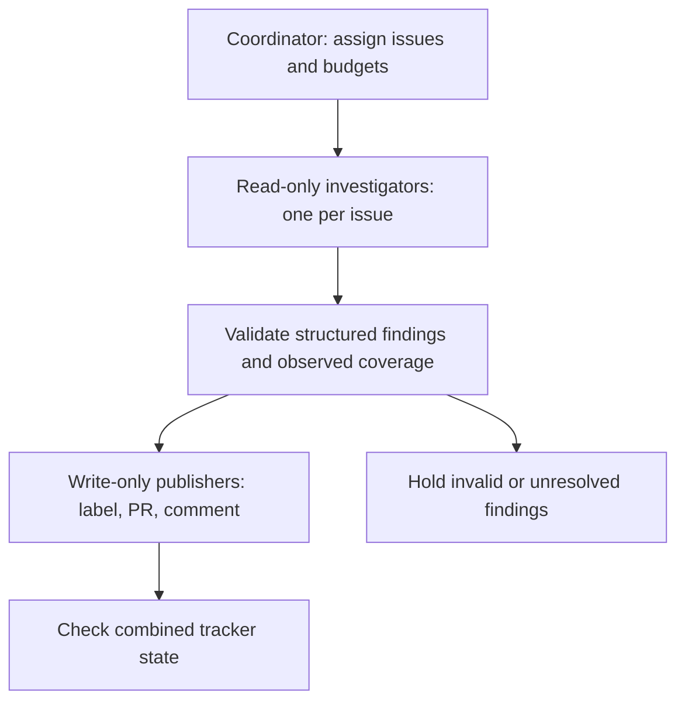

# Assignment 6 · Split it, measure it, decide

Model: OpenAI gpt-4o, copied from Assignment 5 and to be held fixed across all runs.

Status (2026-11-13): prediction commit a9df821 is on main and origin/main.
The original course suite passed (107 tests, two skips) with Windows GC before
temp cleanup, and the gpt-4o tool-calling ping passed. Part B code and free
scripted plumbing checks are in the restored `lab-06-split` branch at e20aa4c;
measured Part C experiment is complete: 72 real runs across S, M and S-plus.
This execution sandbox still fails DNS resolution for api.openai.com, while the
user's PowerShell ping passed. The
second real development probe passed the grounded check; the first had stopped
without a structured worker return and prompted a code correction. S completed all
24 baseline runs: 18/18 single tasks passed, while 2/6 five-issue batches passed.
Mean spend was 31,929 tokens per single and 303,596 per batch. M and S-plus each
completed 24 runs. The instructor's separate handout is still unavailable.

## Part A · The gates, before you build

**The roles you considered, and what each would need from the others mid-task.**

| Two roles | What one needs from the other while the task runs | How it would get it | What that costs |
|---|---|---|---|
| Investigator and publisher | Publisher needs label, responsible file and evidence before any write | Validated structured return through coordinator | Extra return/schema/context tokens and a serial dependency |
| Investigators for different issues | No other issue's answer is needed for independent triage | Separate contexts; coordinator joins results | Duplicated instructions and scheduling; potential batch latency reduction |
| Coordinator and workers | Workers need issue assignment and budget; coordinator needs coverage and uncertainty | Bounded tasks and validated return events | Allocation, validation, shared-state and final-state checks |

- For one issue: research and publication are dependent stages. Splitting them
  introduces a handoff without independent work to overlap.
- For a batch of five: the investigations can overlap in separate contexts;
  publication follows validated findings and is serialized by the coordinator.

**The sketch** (text, or an image in `reports/`):

**The four gates** (slide 46), in order, stopping at the first no.

| Gate | One issue | Why | A batch of five | Why |
|---|---|---|---|---|
| 1. The parts work mostly without talking | fail | Publication depends on investigation | pass | Different issues can be investigated independently |
| 2. Each part's result can be checked on its own | not_reached | Stopped at gate 1 | pass | Schema, observed reads and per-issue invariants can be checked; semantic correctness still needs evaluation |
| 3. A team buys what one agent cannot get more cheaply | not_reached | Stopped at gate 1 | pass | Hypothesis: overlapping independent investigations reduces batch latency |
| 4. The result is worth the multiplier | not_reached | Stopped at gate 1 | fail | M had no batch passes and improved mean wall time by only 18.7%, below the predicted 25%; its accuracy was worse than S |

- The benefit being tested is lower batch latency through parallel independent
  investigations, with possible reduction in cross-issue context mistakes. It
  requires genuinely independent issues and concurrent calls within the shared
  budget; additional roles alone do not provide this benefit.
- Prediction: prefer a single agent for one issue; consider a batch split only
  if measured benefit justifies its actual spend. Expected M/S token ratios are
  1.2-2.0 for singles and 0.7-1.5 for batches. These are hypotheses.
- `reports/PREDICTIONS_06.md` was committed alone as a9df821 on main and
  pushed before split implementation. It has not been revised.

## Part B — The split

- Coordinator: creates an issue-scoped investigator for each task issue,
  validates every structured return, joins the accepted findings, serializes
  publication, and checks the combined tracker state. Batch investigations
  run concurrently; writes run in task order.
- Investigator: receives only read_issue, search_repo and read_file plus a
  local return_finding tool. The dispatch wrapper also rejects unadvertised
  calls and reads of another issue. Publisher: receives only apply_label,
  open_pr and post_comment, restricted to the accepted issue, label and file,
  and enforces label → optional PR → comment. The existing registry hook still
  mediates every course tool call; code inserts the disclosure line.
- Return contract: `result` has issue, label, file and evidence; `status` is
  found/candidate/out_of_budget; `searched` contains actual query/path inputs;
  `not_searched` and `could_not_determine` state gaps; `calls_used` counts actual
  course tool calls. The wrapper derives `searched` and `calls_used` from calls,
  including unsuccessful attempts. The coordinator records `worker_return`
  before acting and checks shape, ownership, uncertainty and evidence.
- Budget: investigations each receive 65% of `ctx.budget` divided across
  issues; publication receives 30% divided across issues, leaving 5% headroom.
  Each loop also has a turn and wall-clock bound. All model calls share the
  harness's run ceiling through agent clients.
- Five checks: (1) return schema and evidence in `ways/split.py`;
  (2) bounded loops and observed calls in `ways/split.py`;
  (3) cycle detection and victim selection in `split/guards.py`;
  (4) versioned compare-and-set in `split/guards.py`;
  (5) task-wide tracker invariants after the last write in `split/guards.py`
  and `ways/split.py`.
- Free evidence: the official guard replays pass for deadlock (8/8), lost
  update (8/8), combined result (8/8). ScriptedWorkers completed one single
  and two batch split runs, plus a single S-plus run without errors. These
  scripted runs do not count as measured accuracy. On the restored branch,
  `split-batch-a-s01-76b5bb` returned five schema-valid findings and passed the
  combined-state check with no run error. A real development run,
  `split-dev-4191-s01-b46dc7`, passed the grounded check (docs, README.md;
  18,752 tokens, $0.035193). Its earlier attempt ended without a structured
  return; `ways/split.py` now requires a return before accepting the worker.

## Part C · Measured

**The five constants** (slide 59): model, tools, budget, evaluator, task set.

**The results.**

| Arm | Kind | Passes / runs | Lowest and highest sweep | Tasks all three passed | Mean tokens | Mean wall-clock (s) |
|---|---|---|---|---|---|---|
| S | single | 18 / 18 | 6–6 | 6 / 6 | 31,929 | 8.8 |
| S | batch | 2 / 6 | 0–1 | 0 / 2 | 303,596 | 44.9 |
| M | single | 10 / 18 | 2–4 | 1 / 6 | 19,339 | 11.8 |
| M | batch | 0 / 6 | 0–0 | 0 / 2 | 107,597 | 36.5 |
| S-plus | single | 4 / 18 | 1–2 | 1 / 6 | 19,837 | 6.5 |
| S-plus | batch | 0 / 6 | 0–0 | 0 / 2 | 69,574 | 18.2 |

- M/S token multipliers were 0.606 for single issues and 0.354 for batches,
  far below the lecture's illustrative 15x. M used fewer tokens in both kinds,
  but accuracy fell from 100% to 55.6% on singles and from 33.3% to 0% on batches.
- S-plus/M mean actual spend by task (tokens): 4402 27,267/24,278 (1.123x);
  4403 13,727/16,850 (0.815x); 4405 30,415/29,091 (1.046x); 4406
  17,836/18,026 (0.989x); 4409 15,279/14,094 (1.084x); 4413
  14,497/13,695 (1.059x); batch-a 84,232/101,100 (0.833x); batch-b
  54,917/114,093 (0.481x). Single-task spend was close overall; batch S-plus
  underspent M, especially batch-b, so that batch comparison is not a clean
  equal-spend control. Means are grounded in finished run_end records.

**Slide 18's three questions**, for each kind of task.

| Question | One issue | A batch of five |
|---|---|---|
| Did the split spend more? | No: 19,339 vs 31,929 mean tokens | No: 107,597 vs 303,596 mean tokens |
| Does spending more raise the score? | No evidence: S-plus spent 19,837 on average and scored 4/18 vs M's 10/18 | No evidence: S-plus scored 0/6, tied M, while spending less; not an equal-spend comparison |
| Given the same budget, did one agent do as well? | No: S-plus 4/18 vs M 10/18 | Yes on observed scores (0/6 each), with S-plus materially underspending M |

- From S and M alone, I would have said the split reduced spend and batch latency,
  but with worse accuracy. S-plus does not support a spend-driven explanation
  for M's result: its single score was lower despite slightly higher mean spend.
  For batches, S-plus did not match M's actual spend and both scored zero. The
  data support keeping the single-agent topology for both task sizes; the batch
  speed gain was below the preregistered threshold and produced no passing batches.

**Every arm M run that failed.**

| Run | What each agent read, wrote and waited on | The first thing that went wrong | Anomaly | MAST category |
|---|---|---|---|---|
| split-batch-a-s01-4de1d8 | inv-4410: searches ['TOKEN_TTL_MINUTES'], reads ['src/config.ts']; pub label=bug, PR, comment; inv-4412: searches ['api/v1/health', 'health'], reads ['src/api/health.ts']; pub label=question, PR, comment; inv-4414: searches ['report list', 'ReportList', 'report']…, reads ['src/components/ReportTable.tsx']; pub not started; inv-4420: searches ['token, password'], reads ['docs/API.md', 'src/api/auth.ts']; pub label=docs, PR, comment; inv-4423: searches ['Accept-Language'], reads ['src/api/errors.ts', 'src/i18n/index.ts']; pub label=bug, PR, comment; coordinator waits on investigator-4410, investigator-4412, investigator-4414, investigator-4420, investigator-4423, publisher-4410, publisher-4412, publisher-4420, publisher-4423; combined=False | investigator-4412 returned issue #4412 as question/src/api/health.ts; expected question/none. The mismatch passed the structural contract and reached publication. | none | task_verification |
| split-batch-a-s02-04a405 | inv-4410: searches ['TOKEN_TTL_MINUTES', 'int('], reads ['src/config.ts']; pub label=bug, PR, comment; inv-4412: searches ['/api/v1/health', 'degraded'], reads ['src/api/health.ts']; pub label=feature, PR, comment; inv-4414: searches ['reports list', 'saved reports', 'reports']…, reads ['src/api/reports.ts']; pub label=feature, PR, comment; inv-4420: searches ['password', 'POST /auth/password-reset/confirm', 'validation failed']…, reads ['src/api/errors.ts', 'src/api/auth.ts', 'docs/API.md']; pub label=docs, PR, comment; inv-4423: searches ['Accept-Language', 'pickLocale', 'pickLocale'], reads ['src/i18n/index.ts']; pub label=bug, PR, comment; coordinator waits on investigator-4410, investigator-4412, investigator-4414, investigator-4420, investigator-4423, publisher-4410, publisher-4412, publisher-4414, publisher-4420, publisher-4423; combined=True | investigator-4412 returned issue #4412 as feature/src/api/health.ts; expected question/none. The mismatch passed the structural contract and reached publication. | none | task_verification |
| split-batch-a-s03-729729 | inv-4410: searches ['TOKEN_TTL_MINUTES'], reads ['src/config.ts']; pub label=bug, PR, comment; inv-4412: searches ['/api/v1/health', 'status: "degraded"', 'health'], reads ['src/api/health.ts']; pub label=question, PR, comment; inv-4414: searches ['reports list', 'saved reports', 'report']…, reads ['src/api/reports.ts']; pub label=feature, PR, comment; inv-4420: searches ['password', 'password-validation', 'password validation']…, reads ['src/api/auth.ts', 'docs/API.md']; pub label=docs, PR, comment; inv-4423: searches ['Accept-Language'], reads ['src/api/errors.ts', 'src/api/uploads.ts', 'src/i18n/index.ts']; pub label=bug, PR, comment; coordinator waits on investigator-4410, investigator-4412, investigator-4414, investigator-4420, investigator-4423, publisher-4410, publisher-4412, publisher-4414, publisher-4420, publisher-4423; combined=True | investigator-4412 returned issue #4412 as question/src/api/health.ts; expected question/none. The mismatch passed the structural contract and reached publication. | none | task_verification |
| split-batch-b-s01-355e36 | inv-4424: searches ['export file name date', 'exportFileName'], reads ['src/exportUtils.ts']; pub label=bug, PR, comment; inv-4426: searches ['amount'], reads ['src/util/money.ts']; pub label=question, PR, comment; inv-4429: searches ['report', 'duplicate'], reads ['src/api/reports.ts', 'docs/API.md']; pub label=bug, PR, comment; inv-4431: searches ['export', 'filename', 'formatExportFilename']…, reads ['src/export/scheduler.ts', 'src/exportUtils.ts', 'src/util/strings.ts']; pub label=feature, PR, comment; inv-4434: searches ['upload error stays on screen', 'upload error', 'file upload']…, reads ['src/components/UploadForm.tsx']; pub label=bug, PR, comment; coordinator waits on investigator-4424, investigator-4426, investigator-4429, investigator-4431, investigator-4434, publisher-4424, publisher-4426, publisher-4429, publisher-4431, publisher-4434; combined=True | investigator-4426 returned issue #4426 as question/src/util/money.ts; expected question/none. The mismatch passed the structural contract and reached publication. | none | task_verification |
| split-batch-b-s02-a68ed8 | inv-4424: searches ['travel-expenses', 'export', 'export']…, reads ['src/export/scheduler.ts', 'src/exportUtils.ts']; pub label=feature, PR, comment; inv-4426: searches ['amount', 'currency', 'yen'], reads ['src/db/client.ts', 'src/db/repos/transactionRepo.ts']; pub label=question, PR, comment; inv-4429: searches ['report', 'duplicate'], reads ['src/api/reports.ts']; pub label=bug, PR, comment; inv-4431: searches ['report-', 'formatExportFilename', 'slugify'], reads ['test/exportUtils.test.ts', 'src/exportUtils.ts', 'src/util/strings.ts']; pub label=bug, PR, comment; inv-4434: searches ['upload error', 'file upload', 'choose a new file']…, reads []; pub not started; coordinator waits on investigator-4424, investigator-4426, investigator-4429, investigator-4431, investigator-4434, publisher-4424, publisher-4426, publisher-4429, publisher-4431; combined=False | investigator-4426 returned issue #4426 as question/src/db/client.ts; expected question/none. The mismatch passed the structural contract and reached publication. | none | task_verification |
| split-batch-b-s03-fbae81 | inv-4424: searches ['export', 'export', 'formatExportFilename']…, reads ['src/exportUtils.ts']; pub label=bug, PR, comment; inv-4426: searches ['amount'], reads ['src/util/money.ts']; pub label=docs, PR, comment; inv-4429: searches ['duplicate report', 'copy'], reads ['src/api/reports.ts']; pub label=bug, PR, comment; inv-4431: searches ['report-', 'formatExportFilename', 'slugify'], reads ['test/exportUtils.test.ts', 'src/exportUtils.ts', 'src/util/strings.ts']; pub label=feature, PR, comment; inv-4434: searches ['upload error', 'Upload', 'file upload']…, reads ['src/components/UploadForm.tsx']; pub label=bug, PR, comment; coordinator waits on investigator-4424, investigator-4426, investigator-4429, investigator-4431, investigator-4434, publisher-4424, publisher-4426, publisher-4429, publisher-4431, publisher-4434; combined=True | investigator-4426 returned issue #4426 as docs/src/util/money.ts; expected question/none. The mismatch passed the structural contract and reached publication. | none | task_verification |
| split-one-4402-s03-127b0d | inv-4402: searches ['The amount is not a number', 'amount', 'currency']…, reads ['src/api/reports.ts', 'src/db/repos/transactionRepo.ts']; pub label=bug, PR, comment; coordinator waits on investigator-4402, publisher-4402; combined=True | investigator-4402 returned issue #4402 as bug/src/db/repos/transactionRepo.ts; expected bug/src/util/money.ts. The mismatch passed the structural contract and reached publication. | none | task_verification |
| split-one-4403-s01-a62b3c | inv-4403: searches ['exportCSV', 'csv', 'writeCsv'], reads ['src/export/csv.ts']; pub label=feature, PR, comment; coordinator waits on investigator-4403, publisher-4403; combined=True | investigator-4403 returned issue #4403 as feature/src/export/csv.ts; expected question/none. The mismatch passed the structural contract and reached publication. | none | task_verification |
| split-one-4403-s02-fa5380 | inv-4403: searches ['EF BB BF', 'BOM'], reads ['src/export/csv.ts', 'src/ingest/parser.ts']; pub label=docs, PR, comment; coordinator waits on investigator-4403, publisher-4403; combined=True | investigator-4403 returned issue #4403 as docs/src/export/csv.ts; expected question/none. The mismatch passed the structural contract and reached publication. | none | task_verification |
| split-one-4403-s03-d216ce | inv-4403: searches ['CSV export', 'export', 'BOM'], reads ['src/export/csv.ts']; pub label=feature, PR, comment; coordinator waits on investigator-4403, publisher-4403; combined=True | investigator-4403 returned issue #4403 as feature/src/export/csv.ts; expected question/none. The mismatch passed the structural contract and reached publication. | none | task_verification |
| split-one-4405-s02-048114 | inv-4405: searches ['export format', 'format menu', 'export button']…, reads ['src/components/ExportButton.tsx']; pub not started; coordinator waits on investigator-4405; combined=False | investigator-4405 reached the 12-call bound without a structured finding; the coordinator held it and made no publication. | none | system_design |
| split-one-4406-s02-ba017c | inv-4406: searches ['Malformed row', 'last row empty line', 'row ends with empty line']…, reads []; pub not started; coordinator waits on investigator-4406; combined=False | investigator-4406 reached the 12-call bound without a structured finding; the coordinator held it and made no publication. | none | system_design |
| split-one-4413-s01-d23c65 | inv-4413: searches ['toast', 'useToast'], reads ['src/components/Toast.tsx']; pub label=feature, PR, comment; coordinator waits on investigator-4413, publisher-4413; combined=True | investigator-4413 returned issue #4413 as feature/src/components/Toast.tsx; expected bug/src/components/Toast.tsx. The mismatch passed the structural contract and reached publication. | none | task_verification |
| split-one-4413-s02-4de404 | inv-4413: searches ['toast'], reads ['src/components/Toast.tsx']; pub label=feature, PR, comment; coordinator waits on investigator-4413, publisher-4413; combined=True | investigator-4413 returned issue #4413 as feature/src/components/Toast.tsx; expected bug/src/components/Toast.tsx. The mismatch passed the structural contract and reached publication. | none | task_verification |

## Part D · The decision

- One issue: choose the single agent. It passed 18/18 versus M's 10/18 and
  S-plus's 4/18. M used fewer tokens than S but was slower on average; additional
  budget in S-plus did not recover M's accuracy.
- A batch of five: choose the single agent. S passed 2/6, while M and S-plus
  passed 0/6. M reduced mean wall time from 44.9 to 36.5 seconds (18.7%), below
  the 25% target, and its token multiplier was 0.354. This small sample does not
  justify the split; S-plus also spent substantially less than M on batch-b.
- Reopen the batch decision only if a held-out repeat shows at least 25% lower
  wall time, no worse all-five accuracy than S, and M/S token multiplier <=1.5.
- The record: `decisions/0006-topology.md`

## AI assistance

Codex reviewed the local README, `checks/FORMATS.md`, checker, report templates
and harness interfaces; drafted the initial Part A analysis and prediction; and
implemented the split, guards, S-plus arm, result aggregation and report drafts.
Codex also summarized the measured runs and drafted the topology decision. The
original suite, API ping, scripted plumbing checks, official guard replays and
`python checks/check_06.py --here` were run; the final working-tree check found
72 finished measured runs and no integrity flags. The separate instructor
handout was not available, and the final Git tags/push have not been performed.
The student should review the analysis and final submission before submitting.
