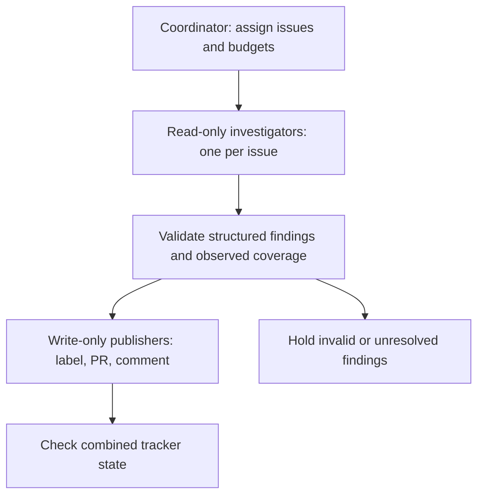

# Assignment 6 · Split it, measure it, decide

Model: OpenAI gpt-4o, copied from Assignment 5 and held fixed across all runs.

Summary: the prediction was committed alone on main as a9df821 before any split
run. The split, its guards and the S-plus control are on `lab-06-split`, tagged
`lab-06-split-final`. The measured experiment has 72 finished real runs: the
eight fixed tasks, three sweeps, in each of S, M and S-plus. S passed 18/18
single issues and 2/6 batches; M passed 10/18 and 0/6; S-plus passed 4/18 and
0/6. The decision keeps the single agent for both task sizes.

## Part A · The gates, before you build

**Roles and dependencies.**

| Two roles | What one needs from the other while the task runs | How it would get it | What that costs |
|---|---|---|---|
| Investigator and publisher | Publisher needs label, responsible file and evidence before any write | Validated structured return through coordinator | Extra return/schema/context tokens and a serial dependency |
| Investigators for different issues | No other issue's answer is needed for independent triage | Separate contexts; coordinator joins results | Duplicated instructions and scheduling; potential batch latency reduction |
| Coordinator and workers | Workers need issue assignment and budget; coordinator needs coverage and uncertainty | Bounded tasks and validated return events | Allocation, validation, shared-state and final-state checks |

- For one issue: research and publication are dependent stages. Splitting them
  introduces a handoff without independent work to overlap.
- For a batch of five: the investigations can overlap in separate contexts;
  publication follows validated findings and is serialized by the coordinator.

**Architecture.**

**The four gates** (slide 46), in order, stopping at the first no.

| Gate | One issue | Why | A batch of five | Why |
|---|---|---|---|---|
| 1. The parts work mostly without talking | fail | Publication depends on investigation | pass | Different issues can be investigated independently |
| 2. Each part's result can be checked on its own | not_reached | Stopped at gate 1 | pass | Schema, observed reads and per-issue invariants can be checked; semantic correctness still needs evaluation |
| 3. A team buys what one agent cannot get more cheaply | not_reached | Stopped at gate 1 | pass | Hypothesis: overlapping independent investigations reduces batch latency |
| 4. The result is worth the multiplier | not_reached | Stopped at gate 1 | fail | Before measurement, there was no evidence that the benefit justified the cost; the default was to keep one agent |

- The benefit being tested is lower batch latency through parallel independent
  investigations, with possible reduction in cross-issue context mistakes. It
  requires genuinely independent issues and concurrent calls within the shared
  budget; additional roles alone do not provide this benefit.
- The original prediction was to prefer a single agent for one issue and consider a batch split only
  if measured benefit justifies its actual spend. Expected M/S token ratios are
  1.2-2.0 for singles and 0.7-1.5 for batches. These were hypotheses; the measured comparison is in Part C.
- `reports/PREDICTIONS_06.md` was committed alone as a9df821 on main and
  pushed before split implementation. It has not been revised.

## Part B — The split

- Coordinator: creates an issue-scoped investigator for each task issue,
  validates every structured return, joins the accepted findings, serializes
  publication, and checks the combined tracker state. Batch investigations
  run concurrently; writes run in task order.
- Investigator: receives only read_issue, search_repo and read_file plus a
  local return_finding tool. The dispatch wrapper also rejects unadvertised
  calls and reads of another issue. Publisher: receives only apply_label,
  open_pr and post_comment, restricted to the accepted issue, label and file,
  and enforces label → optional PR → comment. The existing registry hook still
  mediates every course tool call; code inserts the disclosure line.
- Return contract: `result` has issue, label, file and evidence; `status` is
  found/candidate/out_of_budget; `searched` contains actual query/path inputs;
  `not_searched` and `could_not_determine` state gaps; `calls_used` counts actual
  course tool calls. The wrapper derives `searched` and `calls_used` from calls,
  including unsuccessful attempts. The coordinator records `worker_return`
  before acting and checks shape, ownership, uncertainty and evidence.
- Budget: investigations each receive 65% of `ctx.budget` divided across
  issues; publication receives 30% divided across issues, leaving 5% headroom.
  Each loop also has a turn and wall-clock bound. All model calls share the
  harness's run ceiling through agent clients.
- Five checks: (1) return schema and evidence in `ways/split.py`;
  (2) bounded loops and observed calls in `ways/split.py`;
  (3) cycle detection and victim selection in `split/guards.py`;
  (4) versioned compare-and-set in `split/guards.py`;
  (5) task-wide tracker invariants after the last write in `split/guards.py`
  and `ways/split.py`.
- Free evidence: the official guard replays pass for deadlock (8/8), lost
  update (8/8), combined result (8/8). ScriptedWorkers completed one single
  and two batch split runs, plus a single S-plus run without errors. These
  scripted runs do not count as measured accuracy. On the restored branch,
  `split-batch-a-s01-76b5bb` returned five schema-valid findings and passed the
  combined-state check with no run error. A real development run,
  `split-dev-4191-s01-b46dc7`, passed the grounded check (docs, README.md;
  18,752 tokens, $0.035193). Its earlier attempt ended without a structured
  return; `ways/split.py` now requires a return before accepting the worker.

## Part C · Measured

**Experiment setup.** All three arms used gpt-4o, the same tool definitions,
evaluator, eight tasks, and `scripted:approve-all` reviewer. S and M had a ceiling
of 250,000 tokens per issue (1,250,000 for a batch). S-plus used each task's mean
M spend as its budget. Thus the budget policy was controlled, but S-plus did not
have the same numerical budget as S and M. Each arm ran three sweeps.

**The results.**

| Arm | Kind | Passes / runs | Lowest and highest sweep | Tasks all three passed | Mean tokens | Mean wall-clock (s) |
|---|---|---|---|---|---|---|
| S | single | 18 / 18 | 6–6 | 6 / 6 | 31,929 | 8.8 |
| S | batch | 2 / 6 | 0–1 | 0 / 2 | 303,596 | 44.9 |
| M | single | 10 / 18 | 2–4 | 1 / 6 | 19,339 | 11.8 |
| M | batch | 0 / 6 | 0–0 | 0 / 2 | 107,597 | 36.5 |
| S-plus | single | 4 / 18 | 1–2 | 1 / 6 | 19,837 | 6.5 |
| S-plus | batch | 0 / 6 | 0–0 | 0 / 2 | 69,574 | 18.2 |

- M/S token multipliers were 0.606 for single issues and 0.354 for batches,
  far below the lecture's illustrative 15x. M used fewer tokens in both kinds,
  but accuracy fell from 100% to 55.6% on singles and from 33.3% to 0% on batches.
Actual spend also needs checking because a matching budget does not guarantee
matching token use:

| Task | M mean tokens | S-plus mean tokens | S-plus / M |
|---|---:|---:|---:|
| one-4402 | 24,278 | 27,267 | 1.123 |
| one-4403 | 16,850 | 13,727 | 0.815 |
| one-4405 | 29,091 | 30,415 | 1.046 |
| one-4406 | 18,026 | 17,836 | 0.989 |
| one-4409 | 14,094 | 15,279 | 1.084 |
| one-4413 | 13,695 | 14,497 | 1.059 |
| batch-a | 101,100 | 84,232 | 0.833 |
| batch-b | 114,093 | 54,917 | 0.481 |

Single-task spend was close overall: S-plus averaged 2.6% more than M. On batches,
S-plus averaged 35.3% less, with most of the shortfall on batch-b. The batch
comparison therefore does not establish performance at equal actual spend.

**Slide 18's three questions**, for each kind of task.

| Question | One issue | A batch of five |
|---|---|---|
| Did the split spend more? | No: 19,339 vs 31,929 mean tokens | No: 107,597 vs 303,596 mean tokens |
| Does spending more raise the score? | Yes in the observed S versus S-plus comparison: 31,929 tokens and 18/18 versus 19,837 and 4/18. This is an association, not an isolated budget effect. | Yes in the observed S versus S-plus comparison: 303,596 tokens and 2/6 versus 69,574 and 0/6. The sample is small and the prompts differ. |
| Given the matched budget, did one agent do as well? | No: S-plus passed 4/18 versus M's 10/18, at similar mean spend. | The scores tied at 0/6, while S-plus spent less. This tie shows neither method handled the batches reliably. |

S and M alone suggest a tradeoff: M used fewer tokens, but S completed more tasks
correctly. S-plus adds a narrower observation: at roughly M's single-task spend,
this single-agent control passed fewer tasks than M. That does not establish a
general advantage for splitting, nor does it explain S's higher score by itself.

There is an important confound: `prompts/splus.md` is a shorter, different prompt
from `prompts/agent.md`. It omits the baseline's detailed label definitions,
search guidance and per-issue completion instructions. The investigator prompt
also differs from S's prompt. The experiment therefore compares complete
implementations, including their prompts; it does not isolate topology or budget
alone. Ten of the 24 S-plus agent traces ended at `token_budget`; the other 14
ended at `model_stopped`. Budget stops can leave publication incomplete, but this
count alone does not explain every failure. Despite its name, S-plus used less
budget than S in this experiment because M's measured spend was lower.

Several predictions were wrong. Both M/S token ratios fell below the predicted
ranges; M's single-task accuracy was lower than expected; and S-plus did not
match M's single-task score. The batch latency improvement was 18.7%, below the
25% threshold. These results support retaining S for now when accuracy is the
priority. They do not show that S is reliable for batches: it passed only 2/6.

**Every failed M run.**

The table records the first incorrect or unresolved worker return in trace order,
plus the agents' reads and publications. Of the 14 failed runs, 12 first failed
on a wrong label or responsible file and two on a missing return. Four workers
hit the turn limit in total: two in those single-task runs and two in batches
that already contained an earlier wrong finding. All anomalies are `none`
because the traces do not show a deadlock, lost update or other inter-agent
anomaly causing these failures. A passing combined-state check means the writes
are consistent with one another; it does not mean the chosen label/file is right.

In the table, `inv` means investigator, `pub` means publisher, and `combined`
is the final consistency check. Query lists show representative searches; the
complete calls are retained in each named trace under `runs/`. Each investigator
read its assigned issue; the file paths below are its additional code-file reads.
For the wrong-finding rows, the return passed the schema check and was published
without a semantic correction.

| Run | What each agent read, wrote and waited on | The first thing that went wrong | Anomaly | MAST category |
|---|---|---|---|---|
| split-batch-a-s01-4de1d8 | inv-4410: searches: `TOKEN_TTL_MINUTES`, reads: `src/config.ts`; publisher label=bug, PR, comment; inv-4412: searches: `api/v1/health`, `health`, reads: `src/api/health.ts`; publisher label=question, PR, comment; inv-4414: searches: `report list`, `ReportList`, `report`…, reads: `src/components/ReportTable.tsx`; publisher not started; inv-4420: searches: `token, password`, reads: `docs/API.md`, `src/api/auth.ts`; publisher label=docs, PR, comment; inv-4423: searches: `Accept-Language`, reads: `src/api/errors.ts`, `src/i18n/index.ts`; publisher label=bug, PR, comment; coordinator waits on investigator-4410, investigator-4412, investigator-4414, investigator-4420, investigator-4423, publisher-4410, publisher-4412, publisher-4420, publisher-4423; combined=False | investigator-4412 returned issue #4412 as question/src/api/health.ts; expected question/none. | none | task_verification |
| split-batch-a-s02-04a405 | inv-4410: searches: `TOKEN_TTL_MINUTES`, `int(`, reads: `src/config.ts`; publisher label=bug, PR, comment; inv-4412: searches: `/api/v1/health`, `degraded`, reads: `src/api/health.ts`; publisher label=feature, PR, comment; inv-4414: searches: `reports list`, `saved reports`, `reports`…, reads: `src/api/reports.ts`; publisher label=feature, PR, comment; inv-4420: searches: `password`, `POST /auth/password-reset/confirm`, `validation failed`…, reads: `src/api/errors.ts`, `src/api/auth.ts`, `docs/API.md`; publisher label=docs, PR, comment; inv-4423: searches: `Accept-Language`, `pickLocale`, `pickLocale`, reads: `src/i18n/index.ts`; publisher label=bug, PR, comment; coordinator waits on investigator-4410, investigator-4412, investigator-4414, investigator-4420, investigator-4423, publisher-4410, publisher-4412, publisher-4414, publisher-4420, publisher-4423; combined=True | investigator-4412 returned issue #4412 as feature/src/api/health.ts; expected question/none. | none | task_verification |
| split-batch-a-s03-729729 | inv-4410: searches: `TOKEN_TTL_MINUTES`, reads: `src/config.ts`; publisher label=bug, PR, comment; inv-4412: searches: `/api/v1/health`, `status: "degraded"`, `health`, reads: `src/api/health.ts`; publisher label=question, PR, comment; inv-4414: searches: `reports list`, `saved reports`, `report`…, reads: `src/api/reports.ts`; publisher label=feature, PR, comment; inv-4420: searches: `password`, `password-validation`, `password validation`…, reads: `src/api/auth.ts`, `docs/API.md`; publisher label=docs, PR, comment; inv-4423: searches: `Accept-Language`, reads: `src/api/errors.ts`, `src/api/uploads.ts`, `src/i18n/index.ts`; publisher label=bug, PR, comment; coordinator waits on investigator-4410, investigator-4412, investigator-4414, investigator-4420, investigator-4423, publisher-4410, publisher-4412, publisher-4414, publisher-4420, publisher-4423; combined=True | investigator-4412 returned issue #4412 as question/src/api/health.ts; expected question/none. | none | task_verification |
| split-batch-b-s01-355e36 | inv-4424: searches: `export file name date`, `exportFileName`, reads: `src/exportUtils.ts`; publisher label=bug, PR, comment; inv-4426: searches: `amount`, reads: `src/util/money.ts`; publisher label=question, PR, comment; inv-4429: searches: `report`, `duplicate`, reads: `src/api/reports.ts`, `docs/API.md`; publisher label=bug, PR, comment; inv-4431: searches: `export`, `filename`, `formatExportFilename`…, reads: `src/export/scheduler.ts`, `src/exportUtils.ts`, `src/util/strings.ts`; publisher label=feature, PR, comment; inv-4434: searches: `upload error stays on screen`, `upload error`, `file upload`…, reads: `src/components/UploadForm.tsx`; publisher label=bug, PR, comment; coordinator waits on investigator-4424, investigator-4426, investigator-4429, investigator-4431, investigator-4434, publisher-4424, publisher-4426, publisher-4429, publisher-4431, publisher-4434; combined=True | investigator-4426 returned issue #4426 as question/src/util/money.ts; expected question/none. | none | task_verification |
| split-batch-b-s02-a68ed8 | inv-4424: searches: `travel-expenses`, `export`, `export`…, reads: `src/export/scheduler.ts`, `src/exportUtils.ts`; publisher label=feature, PR, comment; inv-4426: searches: `amount`, `currency`, `yen`, reads: `src/db/client.ts`, `src/db/repos/transactionRepo.ts`; publisher label=question, PR, comment; inv-4429: searches: `report`, `duplicate`, reads: `src/api/reports.ts`; publisher label=bug, PR, comment; inv-4431: searches: `report-`, `formatExportFilename`, `slugify`, reads: `test/exportUtils.test.ts`, `src/exportUtils.ts`, `src/util/strings.ts`; publisher label=bug, PR, comment; inv-4434: searches: `upload error`, `file upload`, `choose a new file`…, reads: none; publisher not started; coordinator waits on investigator-4424, investigator-4426, investigator-4429, investigator-4431, investigator-4434, publisher-4424, publisher-4426, publisher-4429, publisher-4431; combined=False | investigator-4426 returned issue #4426 as question/src/db/client.ts; expected question/none. | none | task_verification |
| split-batch-b-s03-fbae81 | inv-4424: searches: `export`, `export`, `formatExportFilename`…, reads: `src/exportUtils.ts`; publisher label=bug, PR, comment; inv-4426: searches: `amount`, reads: `src/util/money.ts`; publisher label=docs, PR, comment; inv-4429: searches: `duplicate report`, `copy`, reads: `src/api/reports.ts`; publisher label=bug, PR, comment; inv-4431: searches: `report-`, `formatExportFilename`, `slugify`, reads: `test/exportUtils.test.ts`, `src/exportUtils.ts`, `src/util/strings.ts`; publisher label=feature, PR, comment; inv-4434: searches: `upload error`, `Upload`, `file upload`…, reads: `src/components/UploadForm.tsx`; publisher label=bug, PR, comment; coordinator waits on investigator-4424, investigator-4426, investigator-4429, investigator-4431, investigator-4434, publisher-4424, publisher-4426, publisher-4429, publisher-4431, publisher-4434; combined=True | investigator-4426 returned issue #4426 as docs/src/util/money.ts; expected question/none. | none | task_verification |
| split-one-4402-s03-127b0d | inv-4402: searches: `The amount is not a number`, `amount`, `currency`…, reads: `src/api/reports.ts`, `src/db/repos/transactionRepo.ts`; publisher label=bug, PR, comment; coordinator waits on investigator-4402, publisher-4402; combined=True | investigator-4402 returned issue #4402 as bug/src/db/repos/transactionRepo.ts; expected bug/src/util/money.ts. | none | task_verification |
| split-one-4403-s01-a62b3c | inv-4403: searches: `exportCSV`, `csv`, `writeCsv`, reads: `src/export/csv.ts`; publisher label=feature, PR, comment; coordinator waits on investigator-4403, publisher-4403; combined=True | investigator-4403 returned issue #4403 as feature/src/export/csv.ts; expected question/none. | none | task_verification |
| split-one-4403-s02-fa5380 | inv-4403: searches: `EF BB BF`, `BOM`, reads: `src/export/csv.ts`, `src/ingest/parser.ts`; publisher label=docs, PR, comment; coordinator waits on investigator-4403, publisher-4403; combined=True | investigator-4403 returned issue #4403 as docs/src/export/csv.ts; expected question/none. | none | task_verification |
| split-one-4403-s03-d216ce | inv-4403: searches: `CSV export`, `export`, `BOM`, reads: `src/export/csv.ts`; publisher label=feature, PR, comment; coordinator waits on investigator-4403, publisher-4403; combined=True | investigator-4403 returned issue #4403 as feature/src/export/csv.ts; expected question/none. | none | task_verification |
| split-one-4405-s02-048114 | inv-4405: searches: `export format`, `format menu`, `export button`…, reads: `src/components/ExportButton.tsx`; publisher not started; coordinator waits on investigator-4405; combined=False | investigator-4405 reached the 12-call bound without a structured finding; the coordinator held it and made no publication. | none | system_design |
| split-one-4406-s02-ba017c | inv-4406: searches: `Malformed row`, `last row empty line`, `row ends with empty line`…, reads: none; publisher not started; coordinator waits on investigator-4406; combined=False | investigator-4406 reached the 12-call bound without a structured finding; the coordinator held it and made no publication. | none | system_design |
| split-one-4413-s01-d23c65 | inv-4413: searches: `toast`, `useToast`, reads: `src/components/Toast.tsx`; publisher label=feature, PR, comment; coordinator waits on investigator-4413, publisher-4413; combined=True | investigator-4413 returned issue #4413 as feature/src/components/Toast.tsx; expected bug/src/components/Toast.tsx. | none | task_verification |
| split-one-4413-s02-4de404 | inv-4413: searches: `toast`, reads: `src/components/Toast.tsx`; publisher label=feature, PR, comment; coordinator waits on investigator-4413, publisher-4413; combined=True | investigator-4413 returned issue #4413 as feature/src/components/Toast.tsx; expected bug/src/components/Toast.tsx. | none | task_verification |

## Part D · The decision

- One issue: choose the single agent. It passed 18/18 versus M's 10/18 and
  S-plus's 4/18. M used fewer tokens than S but was slower on average. S-plus
  had a lower budget than S and a different prompt, so its lower score cannot
  be attributed to budget alone. This choice prioritizes accuracy over token cost.
- A batch of five: choose the single agent. S passed 2/6, while M and S-plus
  passed 0/6. M reduced mean wall time from 44.9 to 36.5 seconds (18.7%), below
  the 25% target, and its token multiplier was 0.354. This small sample does not
  justify the split; S-plus also spent substantially less than M on batch-b.
- Reopen the batch decision only if a held-out repeat shows at least 25% lower
  wall time, no worse all-five accuracy than S, and M/S token multiplier <=1.5.
- The record: `decisions/0006-topology.md`

## Prompt storage follow-up

After the measured experiment, the investigator task brief, retry instruction and
publisher task brief were extracted into prompt files without changing the
rendered text. The update was checked with 27 byte-identical prompt comparisons
and a free five-issue ScriptedWorkers batch. The 72 measured results describe the
original run-time text and have been retained; this follow-up changes file layout
only. The prompt comparisons and the free batch check both passed.

## AI assistance

Codex drafted the prediction, implementation, aggregation code, report and
decision record from the repository instructions. It also inspected the traces,
checked the reported figures and revised the interpretation and wording. Claude
Code subsequently audited the submission, ran the main-branch checker, cleaned
up working files and revised the opening summary.

Checks performed included the original test suite and API ping, guard replays,
free scripted runs, and the final Assignment 6 checker. The measured results
come from the tracker and run traces, not from agent claims of success. The
separate instructor handout was not available for this review.
